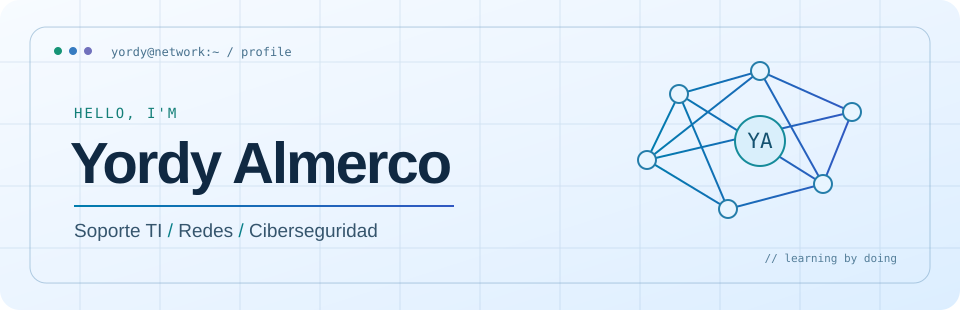
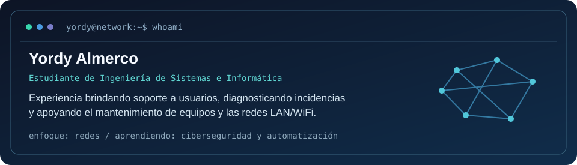
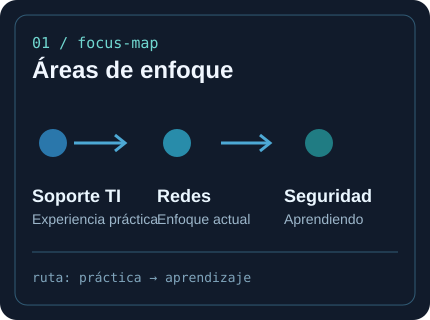
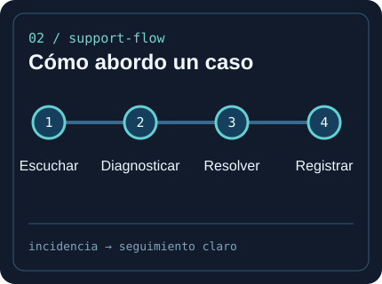

  <a href="https://portafolio-v0-topaz.vercel.app/">
    <picture>
      <source media="(prefers-color-scheme: dark)" srcset="assets/banner-dark-v2.svg">
      <source media="(prefers-color-scheme: light)" srcset="assets/banner-light-v2.svg">
      
    </picture>
  </a>
    
  

---

## `$ whoami`

  

---

## `$ cat tech-stack.yaml`

<table border="1" cellpadding="16">
  <thead><tr><th colspan="2" align="left"><code>yordy@network:~$ cat tech-stack.yaml</code></th></tr></thead>
  <tr>
    <td width="50%" valign="top">
      <code>├─ soporte_y_sistemas:</code>  
        
      <code>Windows · Linux básico · GLPI AnyDesk · TeamViewer · Diagnóstico</code>
    </td>
    <td width="50%" valign="top">
      <code>├─ redes:</code>  
        
      <code>LAN/WiFi · Routers básicos · Cisco VLAN · DHCP · ACL</code>
    </td>
  </tr>
  <tr>
    <td width="50%" valign="top">
      <code>├─ automatización_y_monitoreo:</code>  
        
      <code>PowerShell · Windows · CIM Monitoreo · Alertas a Discord</code>
    </td>
    <td width="50%" valign="top">
      <code>╰─ desarrollo_y_herramientas:</code>  
        
      <code>Git · Java · Python básico Next.js · TypeScript</code>
    </td>
  </tr>
  <tfoot><tr><td colspan="2" align="left"><code>base: soporte TI · rumbo: redes y ciberseguridad</code></td></tr></tfoot>
</table>

---

## `$ netstat --focus-areas`

  &nbsp;
  

<code>signals: experiencia práctica · aprendizaje continuo · documentación</code>

---

## `$ connect --socials`

  
  
  

