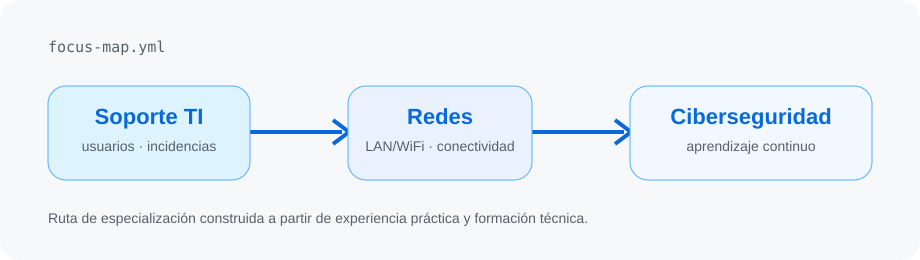
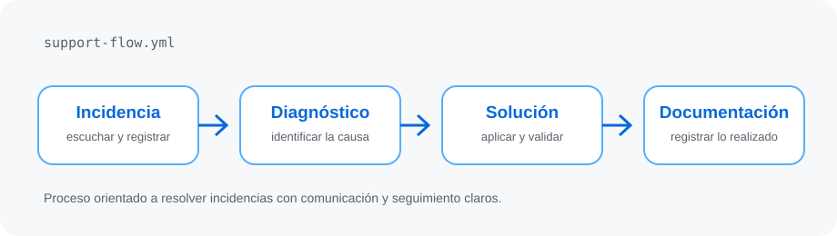

<div align="center">
  <a href="https://portafolio-v0-topaz.vercel.app/">
    <picture>
      <source media="(prefers-color-scheme: dark)" srcset="assets/banner-dark-v2.svg">
      <source media="(prefers-color-scheme: light)" srcset="assets/banner-light-v2.svg">
      
    </picture>
  </a>
  <br><br>
  
</div>

---

## `$ whoami`

Soy estudiante de Ingeniería de Sistemas e Informática. Tengo experiencia brindando soporte técnico a usuarios, diagnosticando incidencias, realizando mantenimiento de equipos y apoyando la configuración de redes LAN/WiFi.

Me interesa seguir creciendo en redes y ciberseguridad. Aprendo con laboratorios y herramientas prácticas de monitoreo y automatización.

```yaml
nombre: Yordy Almerco
experiencia: soporte TI y conectividad
enfoque_actual: redes y ciberseguridad
forma_de_trabajar: diagnosticar → resolver → documentar
```

---

## `$ cat tech-stack.yaml`

<table>
  <tr>
    <td width="50%" valign="top">
      <h3>01 / Soporte y sistemas</h3>
      <p>Windows · Linux básico · GLPI<br>AnyDesk · TeamViewer · Diagnóstico</p>
      <sub>Atención a usuarios, equipos e incidencias.</sub>
    </td>
    <td width="50%" valign="top">
      <h3>02 / Redes</h3>
      <p>LAN/WiFi · Routers básicos · Cisco<br>VLAN · DHCP · ACL</p>
      <sub>Conectividad y laboratorios de redes.</sub>
    </td>
  </tr>
  <tr>
    <td width="50%" valign="top">
      <h3>03 / Automatización y monitoreo</h3>
      <p>PowerShell · Windows · CIM<br>Monitoreo · Alertas a Discord</p>
      <sub>Scripts y seguimiento de recursos del sistema.</sub>
    </td>
    <td width="50%" valign="top">
      <h3>04 / Desarrollo y herramientas</h3>
      <p>Git · Java · Python básico<br>Next.js · TypeScript</p>
      <sub>Herramientas usadas en proyectos y aprendizaje.</sub>
    </td>
  </tr>
</table>

---

## `$ netstat --focus-areas`

<div align="center">
  <picture>
    <source media="(prefers-color-scheme: dark)" srcset="assets/focus-map-dark.svg">
    <source media="(prefers-color-scheme: light)" srcset="assets/focus-map-light.svg">
    
  </picture>
  <br><br>
  <picture>
    <source media="(prefers-color-scheme: dark)" srcset="assets/support-flow-dark.svg">
    <source media="(prefers-color-scheme: light)" srcset="assets/support-flow-light.svg">
    
  </picture>
</div>

---

## `$ connect --socials`

<div align="center">
  <a href="https://portafolio-v0-topaz.vercel.app/"></a>
  <a href="https://www.linkedin.com/in/yordy-almerco/"></a>
  <a href="mailto:yordy.k.almerco@gmail.com"></a>
</div>
