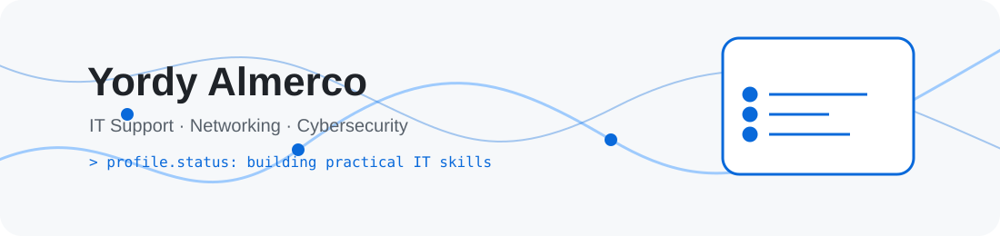

  <a href="https://portafolio-v0-topaz.vercel.app/">
    <picture>
      <source media="(prefers-color-scheme: dark)" srcset="assets/banner-dark.svg">
      <source media="(prefers-color-scheme: light)" srcset="assets/banner-light.svg">
      
    </picture>
  </a>

    

  

---

## $ whoami

> Soy estudiante de Ingeniería de Sistemas e Informática con experiencia en soporte TI y enfoque en redes. He brindado asistencia técnica a usuarios, realizado mantenimiento de equipos y apoyado la configuración de redes LAN/WiFi.

<table>
  <tr>
    <td width="33%"><strong>En qué aporto</strong> Diagnóstico de incidencias, soporte a usuarios y mantenimiento de equipos.</td>
    <td width="33%"><strong>En qué me enfoco</strong> Conectividad LAN/WiFi, redes y documentación técnica.</td>
    <td width="33%"><strong>Qué sigo aprendiendo</strong> Ciberseguridad, automatización y servicios en la nube.</td>
  </tr>
</table>

---

## $ cat tech-stack.yaml

<table>
  <tr>
    <td width="50%" valign="top">
      <strong>🖥️ soporte_y_sistemas</strong>  
       
      Windows · Linux básico · GLPI · AnyDesk · TeamViewer · Diagnóstico
    </td>
    <td width="50%" valign="top">
      <strong>🌐 redes</strong>  
       
      LAN/WiFi · Routers básicos · VLAN · DHCP · ACL · Cisco Networking
    </td>
  </tr>
  <tr>
    <td width="50%" valign="top">
      <strong>⚙️ automatización_y_monitoreo</strong>  
       
      PowerShell · Monitoreo de Windows · CIM · Alertas a Discord
    </td>
    <td width="50%" valign="top">
      <strong>💻 desarrollo_y_herramientas</strong>  
       
      Git · Java · Python básico · Next.js · TypeScript
    </td>
  </tr>
</table>

---

## $ netstat --focus-areas

  <picture>
    <source media="(prefers-color-scheme: dark)" srcset="assets/focus-map-dark.svg">
    <source media="(prefers-color-scheme: light)" srcset="assets/focus-map-light.svg">
    
  </picture>
  <picture>
    <source media="(prefers-color-scheme: dark)" srcset="assets/support-flow-dark.svg">
    <source media="(prefers-color-scheme: light)" srcset="assets/support-flow-light.svg">
    
  </picture>

---

## $ connect --socials

  
  
  
  

